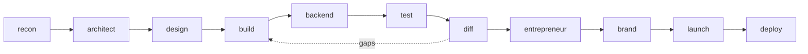

<div align="center">

# 🔍 Reverse Engineer Any App: Claude Code Skills

**Turn any app into a recon map, then rebuild it as your own product.**
11 Claude Code skills that take you from *"how does this app work?"* to a live, rebranded app on your own domain.

[](https://docs.claude.com/en/docs/claude-code)
[](#the-11-skills)
[](#built-in-tools)
[](#the-rules)
[](LICENSE)
[](https://github.com/realtahailyas/reverse-engineer-app-skills/actions/workflows/validate.yml)

[Install](#install) · [Quick start](#quick-start) · [The 11 skills](#the-11-skills) · [Example](#example-reverse-engineering-calendly) · [Prompts](examples/prompts.md)

</div>

---

## What it does

You give Claude Code an app: a URL, an App Store link, or just a name. The **Replica** skills then:

1. **Reverse engineer it.** Every screen, user flow, UI component, the inferred data model and a weighted feature matrix.
2. **Plan your version.** Stack, SQL schema with indexes and access rules, every API route, build order.
3. **Rebuild it.** Design tokens, components, every screen with every state, real backend, Stripe, email.
4. **Prove it.** Playwright tests, bug reports, and a parity score against the original.
5. **Make it better and make it yours.** Mine real user reviews for what people hate, rebrand, launch, deploy.

Works for SaaS, web apps, iOS and Android apps, marketplaces, games and dashboards.



## Install

**Option 1: one line (macOS / Linux / Git Bash)**

```bash
curl -fsSL https://raw.githubusercontent.com/realtahailyas/reverse-engineer-app-skills/main/install.sh | sh
```

**Option 2: Windows PowerShell**

```powershell
irm https://raw.githubusercontent.com/realtahailyas/reverse-engineer-app-skills/main/install.ps1 | iex
```

Piping a script into a shell runs it straight away. To check it first, open [`install.sh`](install.sh) or [`install.ps1`](install.ps1), or download it and read it before running.

**Option 3: Claude Code plugin marketplace**

```
/plugin marketplace add realtahailyas/reverse-engineer-app-skills
/plugin install replica@reverse-engineer-app-skills
```

**Option 4: manual**

```bash
git clone https://github.com/realtahailyas/reverse-engineer-app-skills
cp -r reverse-engineer-app-skills/skills/replica-* ~/.claude/skills/
```

Skills in `~/.claude/skills/` are available in **every** project. Restart Claude Code after installing.

## Quick start

Open Claude Code in an empty folder and type:

```
/replica-recon Reverse engineer Calendly: screens, flows, components,
data model and feature matrix. Then plan it with /replica-architect.
```

Or just say *"reverse engineer Notion"*, *"how does Calendly work"* or *"I want to build my own version of Duolingo"*. The skills trigger on their own.

## The 11 skills

| # | Skill | What it does | Writes |
|---|---|---|---|
| 1 | **`/replica-recon`** | Reverse engineers the app: screen inventory (S01…), user flows (F01…), components, inferred data model with evidence, feature matrix, what cannot be cloned, size estimate | `replica/recon.md`, `features.csv` |
| 2 | **`/replica-architect`** | Picks a boring, managed stack, turns the data model into real SQL, lists every route by flow, orders the build as a vertical slice | `architecture.md`, `schema.sql` |
| 3 | **`/replica-design`** | Measures colour roles, type scale, spacing, radius, shadow; writes design tokens and component specs with every state; WCAG contrast check | `design/tokens.json`, `components.md` |
| 4 | **`/replica-build`** | App shell, then the core loop end to end, then screen by screen with empty, loading, error, mobile and keyboard states | your app, `build-log.md` |
| 5 | **`/replica-backend`** | Auth, migrations, row level security, Stripe Checkout + webhooks, email, jobs, official-API integrations, security checklist | server code, `backend.md` |
| 6 | **`/replica-test`** | Test plan from the flows, Playwright e2e specs with axe accessibility checks, bug reports with severity | `test-plan.md`, `bugs.md`, `e2e/` |
| 7 | **`/replica-diff`** | Feature parity score (must/should/could weighted) and a screenshot layout diff that ignores colour | `parity.md` |
| 8 | **`/replica-entrepreneur`** | Reads real reviews (App Store, Play, G2, Reddit, HN…), ranks what users hate and what is missing, picks a positioning angle | `feedback.md`, `fixes.md` |
| 9 | **`/replica-brand`** | Name candidates with trademark/domain checks, new palette, logo brief, voice, and a sweep for anything left from the original | `brand.md`, `brand.json` |
| 10 | **`/replica-launch`** | Landing page, pricing against the original's public pricing, App Store / Play listing linter | `launch/` |
| 11 | **`/replica-deploy`** | Preflight gate, production DB and env vars, DNS + email records, Stripe live, monitoring, TestFlight / Play | `deploy.md` |

## Built-in tools

Standard-library Python. No `pip install`.

| Tool | Skill | Does |
|---|---|---|
| `parity.py` | diff | Feature parity score + missing list in build order |
| `imgdiff.py` | diff | Screenshot layout diff (edge maps, colour ignored) with a diff image |
| `contrast.py` | design | WCAG 2.2 contrast check of every text/background pair |
| `reviews.py` | entrepreneur | Ranks real reviews into themes, every quote verbatim and linked |
| `sweep.py` | brand | Finds the original's name, domains and colours left in your code |
| `listing.py` | launch | Lints App Store / Google Play listings against limits and copycat rules |

```bash
python3 skills/replica-diff/parity.py replica/features.csv
python3 skills/replica-diff/imgdiff.py original.png clone.png --out diff.png
python3 skills/replica-design/contrast.py replica/design/tokens.json
```

## Example: reverse engineering Calendly

```
/replica-recon Reverse engineer Calendly. Scope: event types, availability,
the public booking page and confirmations. Web first.
```

What you get in `replica/recon.md`:

- **Sources table**: help center, pricing page, changelog, store listing, walkthroughs, each with a URL
- **Screens**: `S01 dashboard`, `S02 event types`, `S03 availability`, `S07 booking page`, `S08 pick a time`, `S10 confirmed`…
- **Flows**: `F01 guest books a meeting: S07 → S08 → S09 → S10`, with click counts and edge cases (slot taken, time zones)
- **Data model**: `User`, `EventType`, `Availability`, `Booking`, each with evidence and confidence
- **Feature matrix**: must / should / could, plus `skip` rows for what you can't clone (their partner network)
- **Size**: calendar sync, time zones and double-booking flagged as the hard parts

Then `/replica-architect`, `/replica-design`, `/replica-build`, and so on. More in [examples/prompts.md](examples/prompts.md).

## The rules

The skills reverse engineer **functionality and UX**, clean-room style. They are built to keep you out of trouble:

- ✅ Public pages, help docs, store listings, public videos, your own account
- ✅ Every line of code, copy, icon and colour written fresh
- ✅ Official public APIs with your own keys
- ❌ No scraping, no bypassing logins or paywalls, no decompiling, no private API endpoints
- ❌ No copying logos, assets, fonts or text; `sweep.py` blocks deploy until the original's name and colours are gone
- ❌ No fake reviews or testimonials

A clone with no reason to exist doesn't sell. `/replica-entrepreneur` finds the reason: what the original's users complain about, fixed in yours.

## Repo layout

```
skills/
  replica-recon/        SKILL.md, recon-map.md, features.csv
  replica-architect/    SKILL.md, architecture.md
  replica-design/       SKILL.md, tokens.json, contrast.py
  replica-build/        SKILL.md
  replica-backend/      SKILL.md
  replica-test/         SKILL.md, test-plan.md, bug-report.md, e2e.example.spec.ts
  replica-diff/         SKILL.md, parity.py, imgdiff.py
  replica-entrepreneur/ SKILL.md, reviews.py, themes.json
  replica-brand/        SKILL.md, sweep.py
  replica-launch/       SKILL.md, listing.py, listing.example.json
  replica-deploy/       SKILL.md, preflight.md
.claude-plugin/         plugin + marketplace manifests
.github/                CI (frontmatter + tool checks), issue and PR templates
examples/prompts.md     copy-paste prompts
```

## FAQ

**Does it work outside Claude Code?** The `SKILL.md` files follow the Agent Skills format, so any agent that reads skills can use them. The Python tools run anywhere.

**Can it clone a mobile app?** Yes. Recon works from the store listing, screenshots and your own device; the build defaults to Expo (React Native).

**Is reverse engineering an app legal?** Studying how an app works from public sources and rebuilding the features yourself is how most software competition works. Copying code, assets, trademarks or breaking terms is not. The skills stay on the right side of that line, but they are not legal advice.

## Contributing

Issues and pull requests are welcome. Read [CONTRIBUTING.md](CONTRIBUTING.md) and the [Code of Conduct](CODE_OF_CONDUCT.md) first; report security problems as described in [SECURITY.md](SECURITY.md). Release notes are in [CHANGELOG.md](CHANGELOG.md).

## License

[MIT](LICENSE) © 2026 Taha Ilyas

---

<div align="center">

Made by [Taha Ilyas](https://github.com/realtahailyas). If it saved you a week, ⭐ the repo.

</div>
